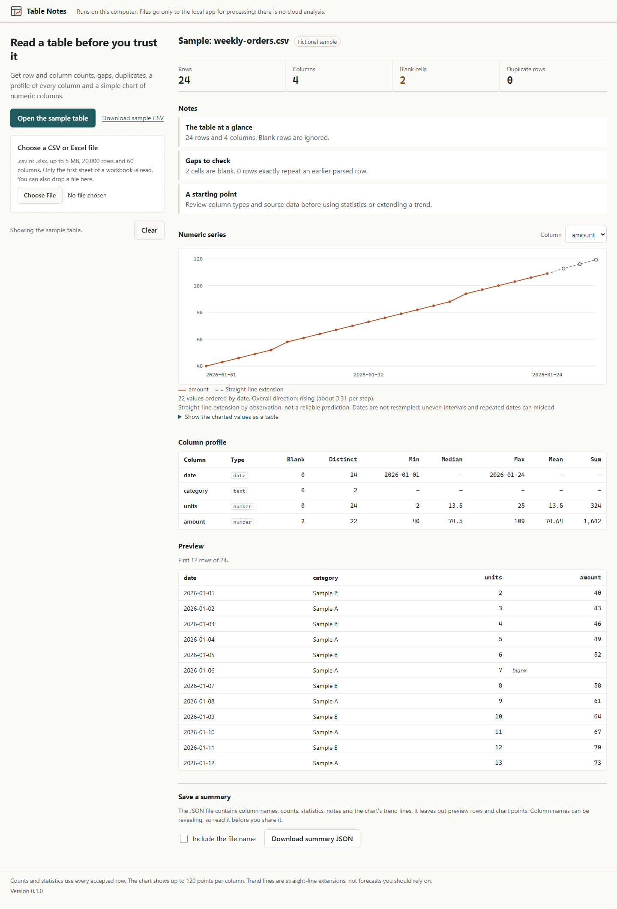

# Table Notes

Open a CSV or Excel table, check its shape, find gaps and explore the numeric columns. Table Notes runs on your computer and does not need an AI account, API key or subscription.



## Try it

Use Python 3.11 or newer. In this directory:

```sh
python -m venv .venv
```

Activate it with `.venv\Scripts\activate` on Windows or `source .venv/bin/activate` on macOS/Linux, then run:

```sh
python -m pip install -c requirements.lock .
table-notes
```

Open **http://127.0.0.1:8127** and choose **Try an example**. The example is generated from fictional categories and amounts. Stop the app with Ctrl+C. Use `table-notes --port 8128` if that port is occupied.

## What it checks

- Row/column counts, blank cells, empty columns and identical parsed rows.
- Inferred text, numeric, boolean and strict ISO date columns. Leading-zero identifiers stay text; numeric IDs never become dates.
- Integers outside the browser's exact safe range are preserved as text, with a warning. Large totals are returned as decimal text too. Numeric means, medians and trends otherwise use floating-point arithmetic and may round; this is not an accounting engine.
- Numeric minimum, median, maximum, mean and sum across all accepted rows.
- A preview and a selectable numeric series. Long series display at most 120 sampled points, while statistics use the whole accepted table.
- A simple straight-line extension when there are at least six observations. This is a descriptive aid, not a reliable prediction. Dates are sorted but not resampled; irregular intervals, repeated dates, seasonality and outliers can make the extension misleading.

The first row supplies unique column names. Blank rows are ignored. Limits are 5 MiB per file, 20,000 physical data rows, 60 columns and 4,096 characters per cell. CSV must be UTF-8; comma, semicolon, tab and pipe delimiters are supported. XLSX reads the first worksheet only. Formulas are displayed as text and never executed or recalculated. Older XLS, macro-enabled XLSM and encrypted workbooks are not supported.

## Your data

The browser sends the selected file to this computer's loopback app. The app analyzes it in memory without saving the upload or creating a database. It makes no outbound requests and the interface uses no external fonts, scripts, analytics or cloud service. Installation downloads Python dependencies.

Reset clears the current browser view and file reference. It is not a promise to wipe process memory, browser internals or operating-system caches. A downloaded summary is a file you choose to save; review its column names and statistics before sharing. Raw preview rows and the uploaded filename are excluded from the default summary export.

This is a trusted, single-user local tool, not an authenticated public upload service. Do not expose it through a public tunnel or shared-network listener. Host/Origin/CSRF guards and byte/archive/row limits reduce specific risks; parsing still runs in the local process without a hard CPU or memory sandbox.

## Development

```sh
python -m pip install -c requirements.lock -e ".[test]"
python -m unittest discover -s tests -v
```

The test files generate synthetic CSV/XLSX data in memory. No customer documents, business exports or credentials are needed. All shipped examples are fictional.

## Design and implementation

The interface was designed and implemented with Claude Code. Codex implemented and reviewed the analysis, local request boundary, tests and packaging. The public edition is new source and original assets; no private repository history or business data is included. See `RESEARCH.md` for the public projects studied and the decisions that followed.

MIT licensed. Maintained by [Jgolding1998](https://github.com/Jgolding1998).
